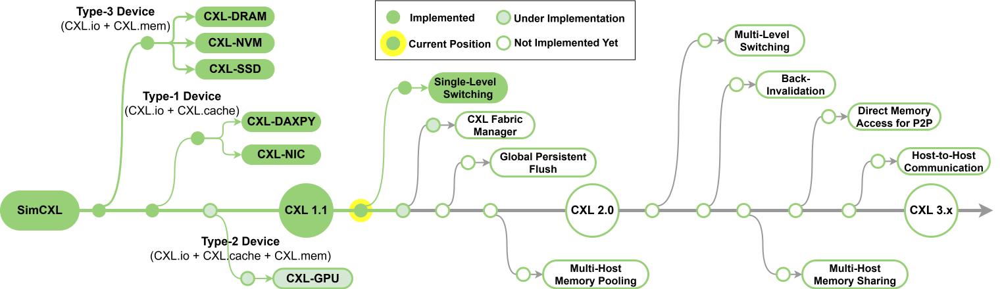

# 

# CXL: BTP experiments with SimCXL

This repository contains the BTP workload environment and simulator-internal
CXL measurements developed on top of
[TianheMICALab/SimCXL](https://github.com/TianheMICALab/SimCXL). Upstream gem5 and
SimCXL source, history, license notices, and citations are retained.

## Current state — 3 September 2026

The CXL instrumentation, offline reporter, guest provisioning, and eight-workload
runner are implemented. The X86 simulator has been built locally, the `all`
guest image has been provisioned, and the memory pilot has completed in the
simulator with a CXL report. **A complete, validated set of results for all eight
workloads is still pending.** This is an experimental implementation, not a
finished benchmark evaluation.

| Area | Current implementation and limits |
|---|---|
| CXL transactions and bytes | Read/write/atomic request counts and payload bytes, globally and by endpoint; link/port traffic attribution |
| Latency | Read/write histograms with minimum, mean, P50/P95/P99, maximum; host-boundary round-trip latency and fabric/queue/device/return-path breakdown |
| Bandwidth and utilization | Fixed-window raw bytes, directional/combined/peak GB/s, utilization against configured capacities, directional activity and overlap |
| Queues and congestion | Time-weighted queue distributions, queue-full events, backpressure, modeled bandwidth stalls, oversubscription, and endpoint imbalance |
| Phases and metadata | Named phase markers and interval reports; topology, capacities, clocks, seed, and source identity |
| Guest workloads | Memory pilot, STREAM, pointer chase, FAISS ANN, BERT, K-means, DLRM, and llama.cpp; full and reduced input sizes |
| Automation | Resumable guest provisioning, sequential suite runner, separate output directories, failure continuation, optional timed calibration |

Metric definitions and model boundaries are in [doc/cxl-metrics.md](doc/cxl-metrics.md).
Issue/completion are measured at the outer CXL boundary; device service includes
backend memory scheduling. Unavailable quantities are reported as `null`.
Collection covers instrumented timing-mode CXL.mem paths, not all upstream CXL
protocols. Current workload wrappers mark the whole workload; separate LLM
prefill/decode phases still require integration into those workloads.

Native-PC, CPU/cache/TLB, and application metrics such as TTFT, tokens/s, or QPS
are **not part of a unified implemented exporter**. Standard gem5 `stats.txt` and
guest stdout are retained for further analysis. GUPS is not configured. Migration,
hotness prediction, cache-hit policies, semantic object tracking, energy,
fairness, and detailed coherence metrics are outside this work's current scope.

## Build, prepare, and run

See [guest/README.md](guest/README.md) for host dependencies, KVM access, disk
space requirements, and libguestfs troubleshooting. From a fresh checkout, after
installing those dependencies:

```bash
make build JOBS=2
python3 guest/setup.py fetch
python3 guest/setup.py sources
python3 guest/setup.py ensure-all --jobs 2
```

Run all eight workloads with original inputs and no trial timeout:

```bash
make workloads-all ARGS="--size full --keep-going --output-dir /tmp/simcxl-full-$(date +%Y%m%d-%H%M%S)"
```

Run all eight with reduced inputs, also to completion without a trial timeout:

```bash
make workloads-all ARGS="--size smoke --keep-going --output-dir /tmp/simcxl-small-$(date +%Y%m%d-%H%M%S)"
```

Each command creates a fresh results directory containing a suite summary,
per-workload logs, gem5 statistics, CXL traces, and completed CXL reports.
`--keep-going` continues after an individual workload failure; inspect the
summary to identify failures. Copy wanted results out of `/tmp` before cleanup
or reboot. Reduced inputs change the workload's memory/cache behavior and are
not equivalent to the full benchmark. BERT and Llama retain full model weights.
**No three-hour or six-hour completion estimate has been validated for the suite.**

Optional `make workloads-trial` samples each reduced workload for up to 45
minutes. It records incomplete samples separately and is not needed for normal
runs. Reporting time is additional to the simulation sampling interval.

## Validation and remaining work

Short Python regression tests cover the metric reporter, setup/retry handling,
model-download redirects, and suite orchestration:

```bash
python3 -m unittest discover -s tests/cxl -p 'test_*.py'
```

These tests do not build gem5, provision images, or run real workloads. They
do not establish full-system correctness or runtime for every workload. The
remaining validation is to complete all eight runs, check their CXL placement
and outputs, and evaluate input sizes using measured timing. The reporter's
interval intersection has been optimized, but large JSONL traces can still
consume substantial disk and memory during postprocessing.

Kernel/disk images, model weights, downloaded source archives, build outputs,
Python environments, and generated results are excluded from Git. Recreate
them using the checked-in setup scripts and pinned manifests. Workload-driver
origins and adaptations are recorded in
[guest/payload/PROVENANCE.json](guest/payload/PROVENANCE.json).

## Upstream SimCXL documentation

SimCXL is a full-system, cycle-level simulator based on gem5 that provides complete support for all three CXL sub-protocols and all three types of CXL devices. 

CXL-DMSim has been integrated into this work.

SimCXL currently supports CXL protocols as follows:
- CXL.io: Supports both Classic and Ruby subsystems.
- CXL.cache: Supports Ruby subsystem only.
- CXL.mem: Supports both Classic and Ruby subsystems.

SimCXL provides examples for three types of CXL devices:
- CXL Type 1 Accelerator：Uses CXL.io and CXL.cache sub-protocols; supports Ruby subsystem only. It does not have device memory.
- CXL Type 2 Accelerator：Uses CXL.io, CXL.cache, and CXL.mem sub-protocols; supports Ruby subsystem only. It includes device memory.
- CXL Type 3 Memory Expander：Uses CXL.io and CXL.mem sub-protocols; supports both Classic and Ruby subsystems. Note that CXL-DMSim uses the Classic subsystem.


## Requirements

To build SimCXL, you need to satisfy the dependencies of gem5 version 23.10. We recommend running on Ubuntu 20.04 or 22.04.

- gcc 9.4.0+
- SCons 3.0+
- Python 3.6+

The main website can be found at [gem5.org](http://www.gem5.org/).

A good starting point is [Introduction to gem5](https://www.gem5.org/documentation/learning_gem5/introduction), and for more information about building the simulator and getting started, please see the [Documentation](http://www.gem5.org/documentation).

## Setup on Ubuntu 20.04 or 22.04

```bash
sudo apt install build-essential git m4 scons zlib1g zlib1g-dev \
    libprotobuf-dev protobuf-compiler libprotoc-dev libgoogle-perftools-dev \
    python3-dev python-is-python3 libboost-all-dev pkg-config libpng-dev
```

## Building SimCXL

1. Once you have successfully installed all of the necessary dependencies, you can clone the SimCXL repository to begin working with it.

   ```bash
   git clone https://github.com/TianheMICALab/SimCXL.git
   ```

2. When building SimCXL, there are multiple binary types that can be created. Just like in gem5, the options are opt, fast, and debug. In general, the opt version is the best in most circumstances. 

   Additionally, SimCXL currently only supports modeling of the x86 architecture.

   If you only intend to experiment with the CXL Type 3 Memory Expander (including both Classic and Ruby-based versions), type the following command to build the simulator:
   

   ```bash
   scons build/X86/gem5.opt -j`nproc`
   ```

   If you intend to experiment with CXL Type 1 and 2 Accelerators, type the following command to build the simulator:

   ```bash
   # first compile config path, required only for the first build
   scons defconfig build/X86_CXL_MESI build_opts/X86
   scons setconfig build/X86_CXL_MESI RUBY_PROTOCOL_CXL_MESI_TWO_LEVEL=y

   scons build/X86_CXL_MESI/gem5.opt -j`nproc`
   ```

Note that the `-j` flag is optional and allows for parallelization of compilation with `nproc` specifying the number of threads. A single-threaded compilation from scratch can take up to 2 hours on some systems. We therefore strongly advise allocating more threads if possible.

## Using SimCXL

SimCXL is a full-system simulator based on gem5. To start the full system, two files are required: a Linux Kernel and a Disk Image.

- **Linux Kernel**: In full-system mode, gem5 boots the operating system by loading a compiled Linux Kernel, which includes necessary resource management modules and device drivers. We provide a [Linux Kernel](https://drive.google.com/drive/folders/1cwqsqxbZm9pCTW3QK33sZPVulQ8d9Lrl) file with added drivers for CXL devices, version 6.12.
- **Disk Image**: In full-system mode, the simulator relies on the Disk Image to run the simulation programs. Users can copy the executable programs to be tested into the Disk Image for execution after the full system starts. We provide a [Disk Image](https://drive.google.com/drive/folders/1cwqsqxbZm9pCTW3QK33sZPVulQ8d9Lrl) that includes the LMbench, Stream, Viper, and Meric test programs.

Both of these files can be created or compiled following the [gem5 documentation](https://www.gem5.org/documentation/general_docs/fullsystem/disks), or downloaded from the [gem5 resources repository](https://resources.gem5.org/).

1. Please check that the paths for `Kernel` and `disk_image` in `configs/example/gem5_library/x86-cxl-xxx.py` correspond to the paths on your computer.

2. Enter the following command to start the full system. By default, it allocates CXL-ASIC Device memory to run the lmbench latency benchmark test. The results of the program execution are saved by default in `m5out/board.pc.com_1.device`.

   ```bash
   sudo ./build/X86/gem5.opt configs/example/gem5_library/x86-cxl-type3-with-classic.py
   ```

For more configurable system component parameters, please refer to the [gem5 standard library](https://www.gem5.org/documentation/gem5-stdlib/overview). You can also use `x86-cxl-x86-cxl-type3-with-classic.py` as a reference to customize your system configuration file.

3. Install `m5term` (Optional).

   `m5term` allows users to connect to the simulated terminal provided by the full system. Follow these steps:

   ```bash
   cd util/term
   make
   sudo install -o root -m 555 m5term /usr/local/bin
   ```

   After starting the full system, enter the terminal with the following command:

   ```bash
   m5term localhost 3456
   ```

## CXL Type 3 Memory Expander: Managing CXL Memory in the Full System

CXL Device is recognized as a CPU-less NUMA node in the system. We provide two ways to manage CXL memory allocation.

1. **Via numactl**

   Users can allocate CXL memory using standard numactl commands, for example:

   ```bash
   numactl --membind=1 --cpunodebind=0 ./lat_mem_rd -t -N 2 1024 64
   ```

   This command will run the `lat_mem_rd` program on CPU0, with memory allocation bound to NUMA node 1, which is the CXL memory in the system. You can also use options like `interleave` and `preferred` to mix DRAM and CXL memory.

2. **Via mmap/memkind**

   The CXL device driver provides an mmap system call to allocate CXL memory.

## CXL Type 1/2 Accelerator

CXL accelerators require customization of device functionality based on specific user requirements. We provide a simple Load Store Unit (LSU) as an example. The LSU includes a device cache; it accesses host memory at cacheline granularity via the CXL.cache protocol and caches the data locally. For a concrete example, please refer to `configs/example/gem5_library/x86-cxl-type1-with-ruby.py`.

Notes:
1. By default, the three CXL device configurations boot using KVM (taking approximately 10+ seconds). Upon entering the full system, the simulation automatically switches to the Timing CPU to execute test programs. If KVM is unavailable, it can be replaced with the Atomic CPU, though this will increase the full-system boot time to approximately 30 minutes.

2. The Ruby subsystem is significantly slower than the Classic subsystem. To accelerate experiments, we recommend reducing the experimental scale and running multiple gem5 instances in parallel.

3. Currently, the ATS address translation mechanism and the Back-Invalidate mechanism are not yet implemented.

## BTP guest setup

See [guest/README.md](guest/README.md) for repository-local kernel/disk setup,
workload provisioning, and CXL data collection. Large downloaded assets and
generated results are excluded from Git.

## CXL metrics

See [the CXL metrics guide](doc/cxl-metrics.md) for opt-in simulator-internal
transaction, latency, bandwidth, queue, congestion, endpoint/link, and phase
reporting. Native and application metrics remain separate.

## Roadmap


## Citation
If you find SimCXL useful for your own work, please cite our papers as follows.
```tex
@INPROCEEDINGS{Cohet,
  author={Wang, Yanjing and Wu, Lizhou and Gao, Sunfeng and Tang, Yibo and Luo, Junhui and Wang, Zicong and Ou, Yang and Dong, Dezun and Xiao, Nong and Lai, Mingche},
  booktitle={2026 IEEE International Symposium on High Performance Computer Architecture (HPCA)}, 
  title={Cohet: A CXL-Driven Coherent Heterogeneous Computing Framework with Hardware-Calibrated Full-System Simulation}, 
  year={2026},
  volume={},
  number={},
  pages={1-16},
  doi={10.1109/HPCA68181.2026.11408611}}


@ARTICLE{CXL-DMSim,
  author={Wang, Yanjing and Wu, Lizhou and Hong, Wentao and Ou, Yang and Wang, Zicong and Gao, Sunfeng and Zhang, Jie and Ma, Sheng and Dong, Dezun and Qi, Xingyun and Lai, Mingche and Xiao, Nong},
  journal={IEEE Transactions on Computer-Aided Design of Integrated Circuits and Systems (TCAD)}, 
  title={CXL-DMSim: A Full-System CXL Disaggregated Memory Simulator With Comprehensive Silicon Validation}, 
  year={2025},
  volume={},
  number={},
  pages={1-1},
  doi={10.1109/TCAD.2025.3607145},
  url={https://ieeexplore.ieee.org/document/11153390}
}
```
